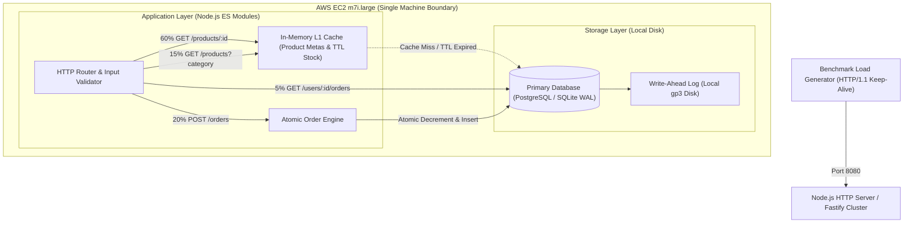
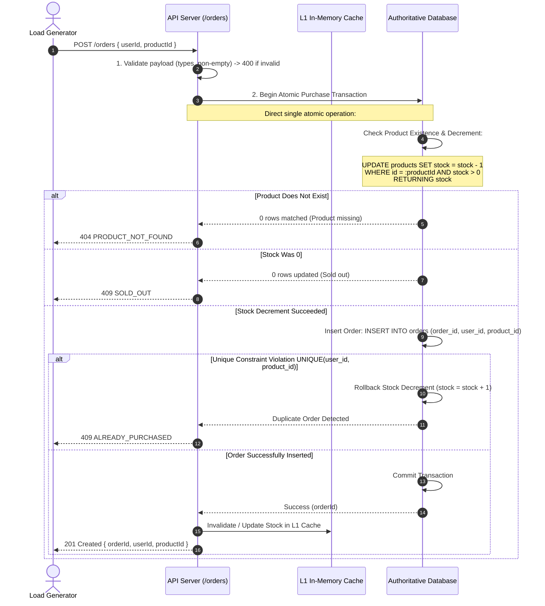

# System Architecture Document
# Last Server Standing — High-Performance Flash Sale Architecture

---

## 1. High-Level Architecture Overview

The system is designed as a high-throughput, low-latency, single-host micro-architecture optimized for an AWS EC2 `m7i.large` instance (2 vCPU, 8 GiB RAM, 30 GiB gp3 SSD).



---

## 2. Hardware Resource Budget (2 vCPU / 8 GiB RAM)

The EC2 `m7i.large` instance features **1 physical core with 2 hyperthreads (Intel Xeon 4th Gen)**. In a 2-vCPU system, excessive OS context switching between numerous processes quickly degrades throughput.

| Component | Target Allocations | CPU Budget | Memory Budget | Notes |
|---|---|---|---|---|
| **Node.js App (Workers)** | 2 Cluster Worker Processes | 1.2 – 1.4 vCPU | 1.5 GiB | 1 worker per vCPU thread; minimizes thread contention |
| **Primary Database** | Local Database Engine | 0.4 – 0.6 vCPU | 2.0 GiB | Tuned buffer pools / page cache |
| **In-Memory Cache** | Node.js V8 Heap (LRU) | Shared with App | 1.0 GiB | Caches 10,000 products & popular query pages |
| **OS & Page Cache** | Linux Kernel 6.8 (Ubuntu 24.04) | 0.1 vCPU | 3.5 GiB | Kernel file system cache, socket buffers |
| **Total** | | **2.0 vCPU** | **8.0 GiB** | Zero swap usage during benchmark |

---

## 3. Database Architecture & Evaluation

The competition rules require that all permanent data be stored in a locally running database that writes to disk, ensuring recovery across restarts without internet access.

### Database Evaluation Matrix:

| Criteria | SQLite 3 (WAL Mode) | PostgreSQL 16 (Local) | MongoDB Community 7 |
|---|---|---|---|
| **Architecture** | In-process C-bindings (`better-sqlite3`) | Client-Server (Unix Domain Socket) | Client-Server (WiredTiger) |
| **Network / IPC Overhead** | **Zero IPC (direct memory pointer)** | Minimal (Unix Domain Socket) | IPC (BSON parsing overhead) |
| **Write Concurrency** | Single writer lock per DB file | **Row-level locking (`FOR UPDATE`)** | Document-level locking |
| **Read Concurrency** | Non-blocking concurrent readers (WAL) | Non-blocking MVCC readers | High concurrent read |
| **Atomic Purchase** | `BEGIN IMMEDIATE` transaction | `UPDATE ... WHERE stock > 0 RETURNING` | `findOneAndUpdate` + multi-doc tx |
| **Multi-Core Scaling** | Requires dedicated writer queue if multi-proc | Native multi-connection pooling | Native connection pooling |
| **Memory Footprint** | Extremely light (~50–100 MB) | Moderate (~200–500 MB) | Heavy (~1–2 GiB cache) |
| **Recovery / Crash Safety** | Instant WAL replay on startup | Robust WAL crash recovery | WiredTiger journal recovery |

### Architectural Decision:
- **Primary Recommendation: SQLite with WAL mode (`better-sqlite3`) with an In-Process Serialized Purchase Worker OR Local PostgreSQL 16 via Unix Domain Socket.**
- **Analysis:**
  - In a 2-vCPU machine, network and serialization overhead matter immensely. SQLite eliminates all TCP/socket overhead, providing sub-millisecond query execution.
  - To handle high-concurrency order creation without SQLite `SQLITE_BUSY` contention, orders are routed through an in-memory transactional execution pipeline or handled via atomic conditional statements (`UPDATE products SET stock = stock - 1 WHERE id = ? AND stock > 0`).
  - PostgreSQL 16 via Unix domain sockets is the top alternate if multi-process clustering with direct parallel row locking is preferred.

---

## 4. Cache Architecture & The 2-Second Rule

The official rules permit specific read caching policies:
1. **Immutable Product Metadata:** `id`, `name`, `category`, and `price` never change after creation. They are cached in memory indefinitely.
2. **Volatile Stock in Reads:** The `stock` field in `GET /products/:id` and category listings may be up to 2 seconds stale.
3. **User Order History:** `GET /users/:userId/orders` may be up to 2 seconds stale.
4. **Order Purchase Decision:** **NEVER CACHED.** Must execute against authoritative, atomic database state.

### Two-Tier In-Memory Cache Design:
- **L1 Fast Lookup (Map / LRU):**
  - Stores all 10,000 seeded products: `{ id, name, category, price, stock, lastStockUpdate }`.
  - When `GET /products/:id` is requested, it serves directly from memory. If `now - lastStockUpdate > 2000 ms`, stock is asynchronously refreshed from the database.
- **Category Query Cache:**
  - Pre-sorted arrays of product references per category: `{ categoryId -> [productRef] }`.
  - Paginated reads slice directly from memory, with stock mapped from the L1 stock registry.
- **Cache Invalidation on Flash Drop:**
  - When `POST /products` launches a new flash drop at the start of a level, the item is immediately injected into the L1 cache.

---

## 5. Atomic Purchase Flow & Invariant Enforcement

To prevent overselling and guarantee all 7 sale invariants, the purchase flow utilizes an atomic test-and-decrement pattern combined with a database-enforced unique constraint.

### Purchase Sequence Diagram:



### Invariant Guarantees:
1. **No Overselling:** Guaranteed by `WHERE stock > 0` condition in the database update.
2. **Exact Accounting:** Every stock decrement is strictly coupled with an order row insertion.
3. **No Negative Stock:** Database column check `CHECK(stock >= 0)`.
4. **One Purchase Per Customer:** Database unique index `UNIQUE(user_id, product_id)`. If duplicate occurs, transaction rolls back stock decrement.
5. **No Lost Orders:** Order is written and committed to disk before HTTP 201 is dispatched.
6. **No Ghost Orders:** If stock reservation fails, no order record is created.
7. **Flash Sale Sell-Through:** Orders never check cached stock to reject purchases; every order hits the authoritative atomic decrement.

---

## 6. Process & Worker Strategy

- **Runtime:** Node.js v24 (or v20 LTS).
- **Architecture:** Node.js Native Cluster with 2 worker processes (matching the 2 vCPUs).
- **Socket Sharing:** Master process binds to `0.0.0.0:8080` with `SO_REUSEPORT` kernel load balancing across the 2 worker processes.
- **Framework:** `Fastify` or high-performance native `node:http`.
  - Fastify provides schema-based serialization via `fast-json-stringify` (2x faster than `JSON.stringify`) and high-efficiency routing.
- **Keep-Alive Configuration:**
  - `keepAliveTimeout: 65000` (65s).
  - `maxRequestsPerSocket: 0` (unlimited).
  - High `backlog` setting (5,000 connections).

---

## 7. Crash Recovery & Reliability

```mermaid
flowchart LR
    ProcessCrash["Unexpected Server Crash (SIGKILL)"] -->|Exit Signal| Systemd["systemd Process Supervisor"]
    Systemd -->|Auto-Restart in < 1s| Master["Master Process (0.0.0.0:8080)"]
    Master -->|Fork| Workers["2 App Workers"]
    Workers -->|Connect| DB["Local Database"]
    DB -->|Replay WAL| Recovery["Instant State Recovery"]
    Recovery -->|Verify Tables & Ready| Healthy["GET /health -> 200 OK"]
```



- **Process Supervision:** Managed via Linux `systemd` unit:
  ```ini
  [Unit]
  Description=Last Server Standing Production API
  After=network.target

  [Service]
  Type=simple
  User=ubuntu
  WorkingDirectory=/home/ubuntu/last-server-standing
  ExecStart=/usr/bin/node src/server.js
  Restart=always
  RestartSec=1
  LimitNOFILE=65535
  Environment=NODE_ENV=production PORT=8080 HOST=0.0.0.0

  [Install]
  WantedBy=multi-user.target
  ```
- **Zero-Internet Reboot:** All Node modules, database binaries, and scripts are stored locally on the root filesystem. Restart requires no network access.

---

## 8. Architecture Decision Records (ADRs)

### ADR-01: Framework Selection — Fastify over Express
- **Context:** Express creates significant garbage collection overhead and slow route matching at 10,000+ RPS.
- **Decision:** Fastify with pre-compiled schema validation and fast JSON serialization.
- **Consequences:** Lower CPU consumption per request, lower p99 latency, minimal garbage collection pauses.

### ADR-02: Database Concurrency — Atomic Single-Query vs Two-Phase Transactions
- **Context:** Separate `SELECT stock` followed by `INSERT order` and `UPDATE stock` causes race conditions and deadlocks under concurrent load.
- **Decision:** Atomic decrement with database-enforced unique constraints and immediate rollback on duplicate error.
- **Consequences:** Eliminates application-level locking bottlenecks and guarantees zero overselling.

### ADR-03: Read Caching Strategy — Dual-State Memory Cache
- **Context:** 60% of traffic is `GET /products/:id` with high skew toward popular products.
- **Decision:** In-memory LRU cache with 2-second background refresh for volatile stock, instant serving for static fields.
- **Consequences:** Takes 60% of the read load off the database engine entirely, reserving CPU and disk I/O for the 20% write load.
