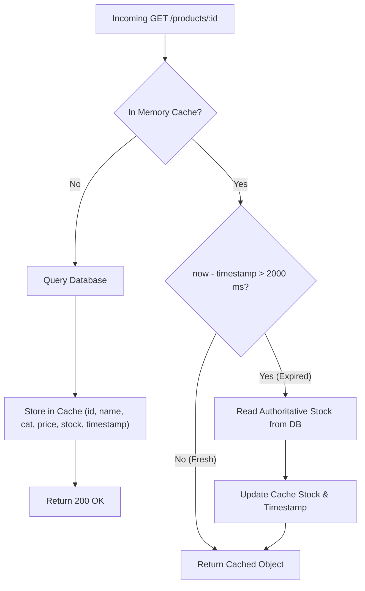

# Technical Design Document
# Last Server Standing — High-Performance Flash Sale API

---

## 1. Directory Structure

The project is structured with strict separation of concerns, modular ES modules, and zero clutter.

```
last-server-standing/
├── deploy/
│   ├── last-server-standing.service   # Systemd unit file for auto-restart
│   ├── limits.conf                    # Linux file descriptor limits
│   └── sysctl.conf                    # Linux kernel networking optimizations
├── src/
│   ├── app.js                         # Application factory & plugin registration
│   ├── server.js                      # Entrypoint (cluster master & workers, listening 0.0.0.0:8080)
│   ├── cache/
│   │   └── productCache.js            # In-memory L1 cache with 2-second stock TTL
│   ├── config/
│   │   └── env.js                     # Environment variables & constants
│   ├── db/
│   │   ├── connection.js              # Database connection & pooling configuration
│   │   ├── schema.sql                 # SQL DDL & table constraints
│   │   └── migrate.js                 # Database schema initialization script
│   ├── routes/
│   │   ├── health.js                  # GET /health
│   │   ├── products.js                # POST /products, GET /products/:id, GET /products
│   │   ├── orders.js                  # POST /orders
│   │   └── users.js                   # GET /users/:userId/orders
│   ├── services/
│   │   ├── productService.js          # Product creation, retrieval & cached listing
│   │   └── orderService.js            # Atomic purchase transaction & user orders
│   └── utils/
│       ├── errors.js                  # Centralized official error responses
│       └── validator.js               # Fast input validation schemas
├── tests/
│   ├── functional.test.js             # Comprehensive ~40 functional test suite
│   ├── concurrency.test.js            # Concurrency Test A (last unit) & Test B (double click)
│   ├── load/
│   │   ├── benchmark.js               # Multi-level load simulation harness (Autocannon)
│   │   └── loadProfile.js             # Traffic distribution generator (60/15/20/5)
│   └── reconciliation.test.js         # Audit verification script
├── PRD.md                             # Product Requirements Document
├── architecture.md                    # Architecture & System Design
├── rules.md                           # Official Rulebook & Constraints
├── phases.md                          # Implementation Roadmap
├── design.md                          # Technical Design
├── memory.md                          # Persistent Project Memory & State
├── package.json                       # Dependencies & scripts
└── README.md                          # Operational Runbook
```

---

## 2. JavaScript & Coding Conventions
- **Language / Runtime:** Node.js (v24 / v20 LTS).
- **Module System:** ECMAScript Modules (`"type": "module"` in `package.json`).
- **Syntax:** Modern JavaScript (ES2023+): `async/await`, optional chaining (`?.`), nullish coalescing (`??`), object destructuring.
- **Naming Conventions:**
  - Files: `camelCase.js` (e.g., `productService.js`).
  - Variables & Functions: `camelCase` (e.g., `createOrder`).
  - Constants: `UPPER_SNAKE_CASE` (e.g., `DEFAULT_PAGE_LIMIT = 20`).
  - Database Columns: `snake_case` (e.g., `product_id`, `created_at`).
  - JSON API Fields: `camelCase` matching official spec (e.g., `userId`, `productId`, `orderId`).

---

## 3. Database Schema & Index Strategy

### DDL Specification:

```sql
-- Products Table
CREATE TABLE IF NOT EXISTS products (
    id VARCHAR(64) PRIMARY KEY,
    name VARCHAR(200) NOT NULL,
    category VARCHAR(64) NOT NULL,
    price INTEGER NOT NULL CHECK (price >= 0),
    stock INTEGER NOT NULL CHECK (stock >= 0),
    created_at TIMESTAMP DEFAULT CURRENT_TIMESTAMP
);

-- Index for category listing sorted by price ASC, then id ASC
CREATE INDEX IF NOT EXISTS idx_products_category_price_id 
ON products (category, price ASC, id ASC);

-- Orders Table
CREATE TABLE IF NOT EXISTS orders (
    order_id VARCHAR(64) PRIMARY KEY,
    user_id VARCHAR(64) NOT NULL,
    product_id VARCHAR(64) NOT NULL REFERENCES products(id),
    created_at TIMESTAMP DEFAULT CURRENT_TIMESTAMP,
    CONSTRAINT uq_user_product UNIQUE (user_id, product_id)
);

-- Index for user order history
CREATE INDEX IF NOT EXISTS idx_orders_user_id 
ON orders (user_id);
```

### Index Justification:
1. `idx_products_category_price_id`: Enables index-only scans for `GET /products?category=...&page=...&limit=...`. The database reads pre-sorted rows directly from the B-tree index without touching disk heap pages or running an expensive runtime `SORT`.
2. `uq_user_product`: Database-enforced uniqueness prevents duplicate purchases at the storage engine level.
3. `idx_orders_user_id`: Accelerates `GET /users/:userId/orders` lookups to sub-millisecond speeds.

---

## 4. Atomic Order Processing Logic

The order purchase logic must avoid two separate queries that create race conditions.

### Implementation Pattern:
```javascript
// Service method: orderService.purchase(userId, productId)
export async function purchaseOrder(userId, productId) {
  // 1. Generate unique order ID
  const orderId = 'o_' + crypto.randomBytes(6).toString('hex');

  // 2. Execute within an immediate transaction
  const result = db.transaction(() => {
    // A. Check if product exists
    const product = db.prepare('SELECT stock FROM products WHERE id = ?').get(productId);
    if (!product) {
      return { status: 404, error: 'PRODUCT_NOT_FOUND' };
    }

    // B. Check if user already purchased
    const existingOrder = db.prepare('SELECT 1 FROM orders WHERE user_id = ? AND product_id = ?').get(userId, productId);
    if (existingOrder) {
      return { status: 409, error: 'ALREADY_PURCHASED' };
    }

    // C. Atomic stock decrement
    const updateResult = db.prepare('UPDATE products SET stock = stock - 1 WHERE id = ? AND stock > 0').run(productId);
    if (updateResult.changes === 0) {
      return { status: 409, error: 'SOLD_OUT' };
    }

    // D. Insert order (unique constraint is a second safety net)
    try {
      db.prepare('INSERT INTO orders (order_id, user_id, product_id) VALUES (?, ?, ?)').run(orderId, userId, productId);
    } catch (err) {
      // If concurrent request bypassed check, rollback stock
      db.prepare('UPDATE products SET stock = stock + 1 WHERE id = ?').run(productId);
      return { status: 409, error: 'ALREADY_PURCHASED' };
    }

    return { status: 201, data: { orderId, userId, productId } };
  })();

  return result;
}
```

---

## 5. In-Memory Cache Design (The 2-Second Rule)



- **Stock TTL:** Exact 2,000 milliseconds.
- **Cache Eviction:** Size-capped LRU map (10,000 items maximum) consuming $< 50\text{ MB}$ RAM.
- **Memory Overhead:** Negligible on an 8 GiB system.

---

## 6. Input Validation & Error Handling Architecture

Fastify's built-in JSON schema validator compiles validation functions into fast native V8 JavaScript code at startup.

### Validation Specifications:
- `POST /products`:
  - `id`: `type: 'string', minLength: 1, maxLength: 64`
  - `name`: `type: 'string', minLength: 1, maxLength: 200`
  - `category`: `type: 'string', minLength: 1, maxLength: 64`
  - `price`: `type: 'integer', minimum: 0`
  - `stock`: `type: 'integer', minimum: 0`
- `GET /products`:
  - `category`: `type: 'string', minLength: 1`
  - `page`: `type: 'integer', minimum: 1, default: 1`
  - `limit`: `type: 'integer', minimum: 1, maximum: 50, default: 20`
- `POST /orders`:
  - `userId`: `type: 'string', minLength: 1, maxLength: 64`
  - `productId`: `type: 'string', minLength: 1, maxLength: 64`

### Centralized Error Handler:
```javascript
app.setErrorHandler((error, request, reply) => {
  if (error.validation) {
    return reply.status(400).send({ error: 'VALIDATION_ERROR' });
  }
  // Log unexpected internal errors only
  request.log.error(error);
  reply.status(500).send({ error: 'INTERNAL_SERVER_ERROR' });
});
```

---

## 7. Logging & Production Performance Policy

> [!CAUTION]
> At 5,000 – 50,000 RPS, standard console logging (`console.log(req.body)` or `morgan('dev')`) creates 5,000+ disk/stdout I/O writes per second, saturating CPU and failing benchmark levels.

- **Production Mode:** Disable all per-request access logging (`logger: false` or `logger: { level: 'error' }`).
- **Errors Only:** Output only critical process lifecycle events (startup, graceful shutdown, database connection failures).

---

## 8. Operating System Tuning & Process Management

### Linux Kernel (`/etc/sysctl.conf`):
```ini
# Max open connections and backlog
net.core.somaxconn = 65535
net.ipv4.tcp_max_syn_backlog = 65535

# Fast socket recycling
net.ipv4.tcp_tw_reuse = 1
net.ipv4.tcp_fin_timeout = 15

# Ephemeral port range for local testing
net.ipv4.ip_local_port_range = 1024 65535

# File descriptors
fs.file-max = 2097152
```

### Systemd Process Supervisor (`/etc/systemd/system/last-server-standing.service`):
```ini
[Unit]
Description=Last Server Standing Production API Server
After=network.target

[Service]
Type=simple
User=ubuntu
WorkingDirectory=/home/ubuntu/last-server-standing
ExecStart=/usr/bin/node src/server.js
Restart=always
RestartSec=1
LimitNOFILE=65535
Environment=NODE_ENV=production PORT=8080 HOST=0.0.0.0

[Install]
WantedBy=multi-user.target
```
